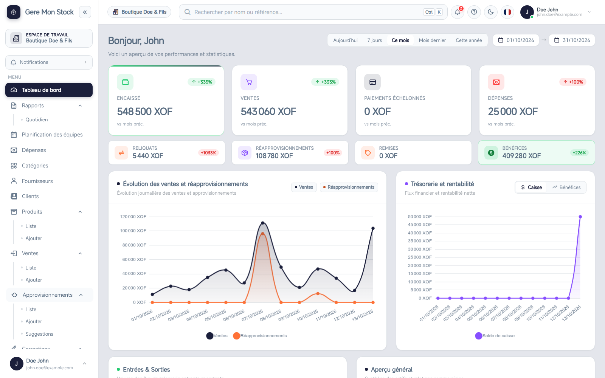
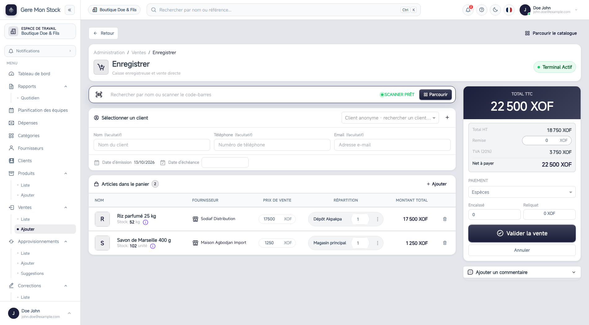
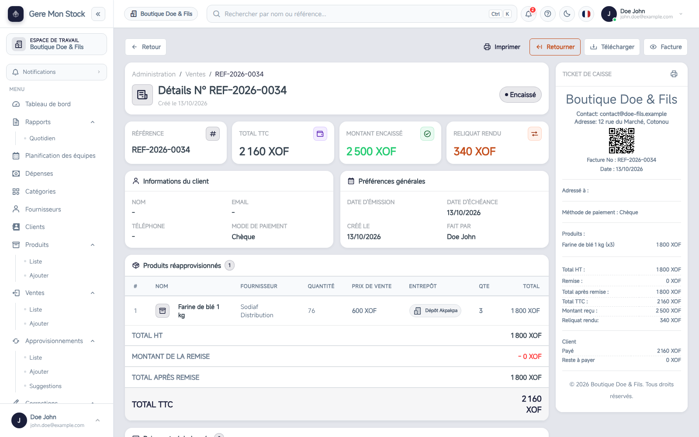
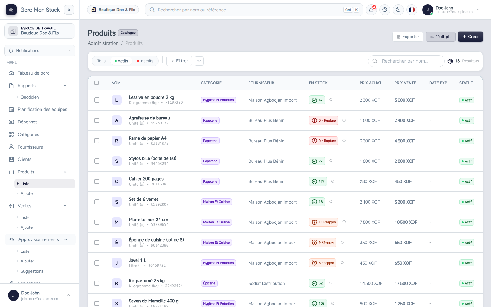
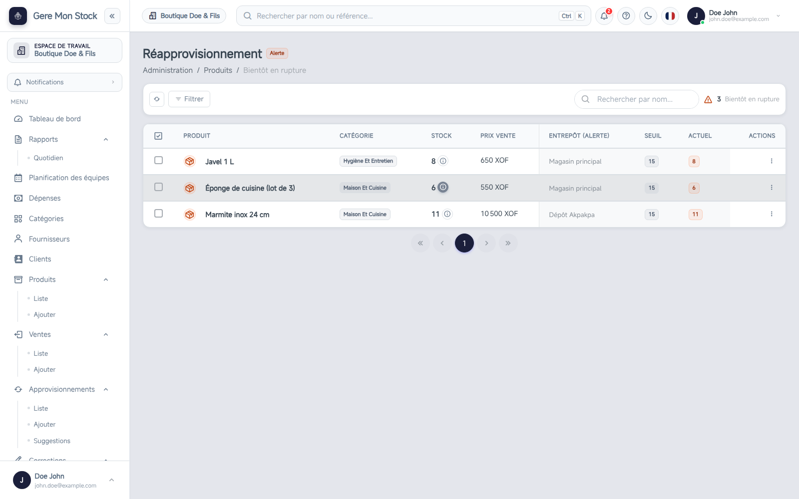
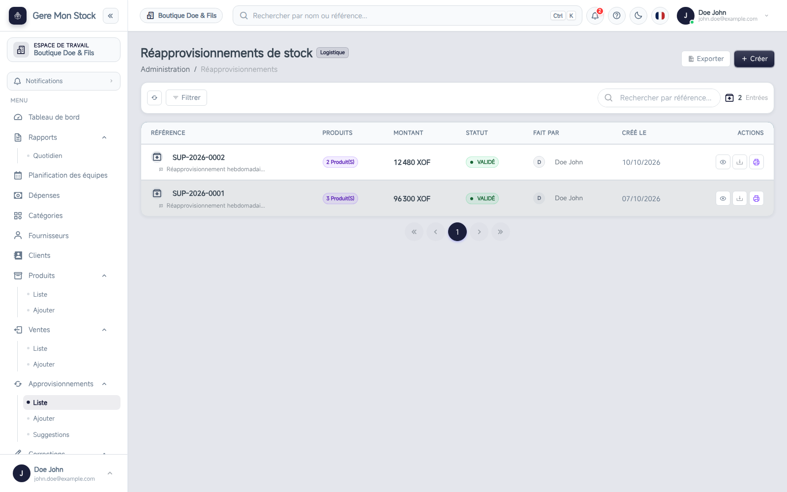
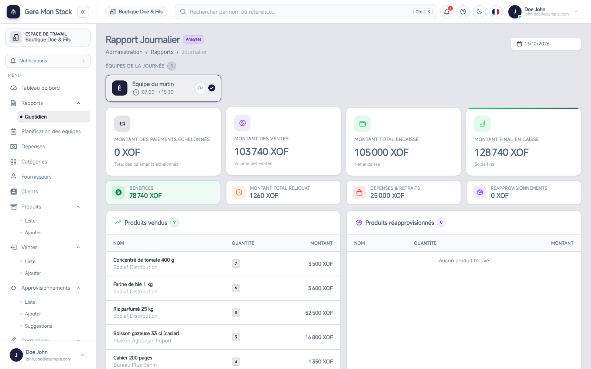
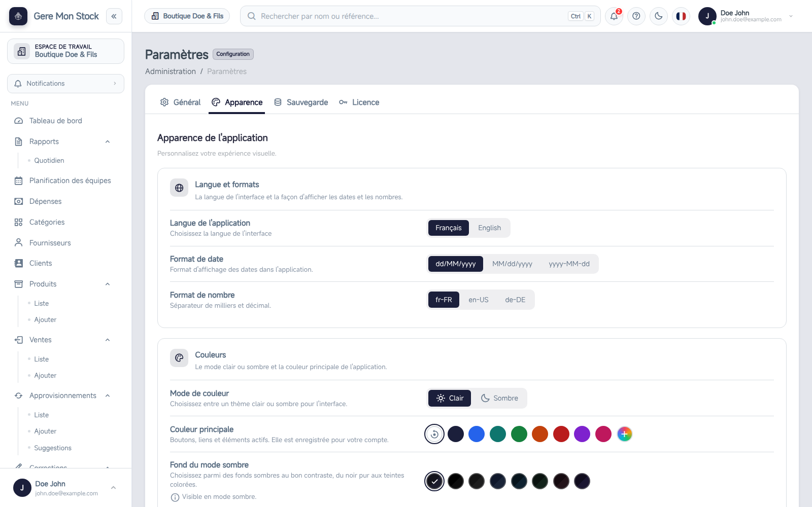
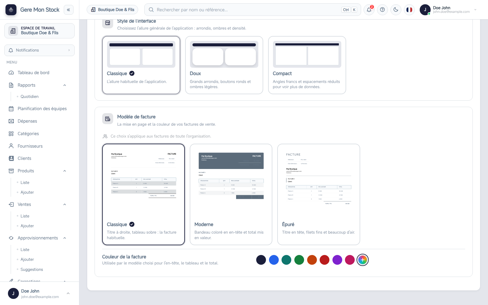
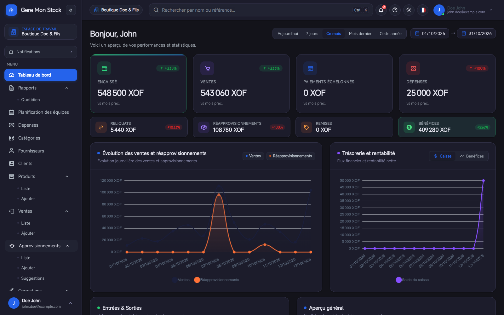

<div align="center">

# Gère Mon Stock — Desktop

**Le logiciel de gestion de stock et de caisse qui tourne sur votre ordinateur, même sans internet.**

Produits, ventes, approvisionnements, rapports, bénéfices : tout votre commerce dans une seule application.

[](https://github.com/search-and-develop/geremonstock-desktop/releases)


[**⬇ Télécharger**](#-télécharger) · [Fonctionnalités](#-fonctionnalités) · [Installation](#-installation) · [Questions fréquentes](#-questions-fréquentes) · [Nous contacter](#-obtenir-une-licence)



</div>

---

## ⬇ Télécharger

**Version bêta v1.0.0-beta.55** — la version stable arrive très bientôt.

| Système | Téléchargement | Installation |
| --- | --- | --- |
| **Windows** 10 / 11 (64 bits) | [**Télécharger pour Windows (.exe)**](https://github.com/search-and-develop/geremonstock-desktop/releases/download/v1.0.0-beta.55/Geremonstock-Setup-1.0.0-beta.55.exe) | Double-cliquez sur le fichier et suivez l'assistant. |
| **Linux** (64 bits, format AppImage) | [**Télécharger pour Linux (.AppImage)**](https://github.com/search-and-develop/geremonstock-desktop/releases/download/v1.0.0-beta.55/Geremonstock-1.0.0-beta.55.AppImage) | Rendez le fichier exécutable puis lancez-le (voir [Installation](#-installation)). |

[Toutes les versions](https://github.com/search-and-develop/geremonstock-desktop/releases) ·
les applications installées se mettent à jour automatiquement.

<!-- A la sortie de la première version stable, remplacer le tableau par ces liens qui servent toujours la dernière
     version stable :
     Windows : https://github.com/search-and-develop/geremonstock-desktop/releases/latest/download/Geremonstock-Setup.exe
     Linux   : https://github.com/search-and-develop/geremonstock-desktop/releases/latest/download/Geremonstock.AppImage -->

Une **clé de licence** est nécessaire pour utiliser le logiciel : voir [Obtenir une licence](#-obtenir-une-licence).

---

## Pourquoi Gère Mon Stock ?

- **Il marche sans internet.** Vos ventes ne s'arrêtent pas quand la connexion tombe : le logiciel, sa base de
  données et sa caisse tournent sur votre machine.
- **Vos données restent chez vous.** Elles sont stockées sur votre ordinateur, sauvegardées chaque nuit, et vous en
  gardez le contrôle.
- **Il se prend en main vite.** Un assistant de première configuration, des visites guidées et un centre d'aide
  intégrés. Pas de formation de plusieurs jours.
- **Il grandit avec vous.** Un poste, ou plusieurs caisses reliées sur le réseau local de votre boutique, avec des
  rôles adaptés à chacun (administrateur, caissier, magasinier).
- **Il s'adapte à votre métier.** Boutique, pharmacie… Les champs, les alertes et le vocabulaire suivent votre
  activité.

---

## ✨ Fonctionnalités

### Un tableau de bord qui répond à « Où en est mon commerce ? »

Encaissé, ventes, dépenses, approvisionnements, remises, **bénéfices** et leur évolution face à la période
précédente. Courbes d'évolution, trésorerie, entrées et sorties : en un coup d'œil, sur la période de votre choix.
Les chiffres sensibles (bénéfices, dépenses) ne sont visibles que par l'administrateur.


### Une caisse rapide et un ticket de caisse prêt à imprimer

Cherchez un produit par nom ou scannez son **code-barres**, choisissez un client (ou restez anonyme), appliquez une
remise, encaissez en espèces, Mobile Money ou chèque : la monnaie à rendre est calculée pour vous. Chaque vente
produit un **ticket de caisse** (impression thermique 80 mm avec QR code) et une **facture** PDF.




### Un catalogue de produits et un stock toujours à jour

Plusieurs **entrepôts**, des catégories, des fournisseurs, des prix d'achat et de vente, des unités, des dates de
péremption. Importez vos produits depuis un **fichier Excel** : les lignes invalides sont signalées et mises de
côté, vous les corrigez avant de valider.



### Des alertes qui vous évitent la rupture (et le surstock)

Produits **en rupture**, **à réapprovisionner**, **bientôt périmés**, en **surstock** : le logiciel vous prévient, et
vous suggère les quantités à commander.



### Approvisionnements, corrections et inventaires

Enregistrez vos réceptions de marchandises par fournisseur et par entrepôt, corrigez le stock avec un motif (casse,
perte, erreur), faites vos inventaires. Chaque mouvement est tracé.



### Le rapport quotidien, équipe par équipe

Organisez vos équipes et vos caisses : à la fermeture, le **rapport journalier** donne pour chaque équipe les
ventes, l'encaissé, les paiements échelonnés, les dépenses, le solde de caisse et le **bénéfice**, avec le détail des
produits vendus.



### Clients, fournisseurs, dépenses, paiements échelonnés

Suivez vos clients et ce qu'ils vous doivent, enregistrez les **paiements échelonnés** d'une vente payée en
plusieurs fois, notez vos dépenses.

---

## 🎨 Votre logiciel, votre allure

Le logiciel se personnalise dans **Paramètres → Apparence** :

- **Couleur principale** : 8 teintes ou la couleur de votre choix.
- **Mode clair ou sombre**, avec **8 fonds sombres** au bon contraste (du noir pur aux teintes colorées).
- **3 styles d'interface** : Classique, Doux (arrondis, boutons ronds) ou Compact (plus de données à l'écran).
- **3 modèles de facture** (Classique, Moderne, Épuré) avec **votre couleur** : l'aperçu se met à jour en direct.
- **Français et anglais**, formats de date et de nombre au choix.





---

## 💾 Sauvegardes et mises à jour

- **Sauvegardes** : une sauvegarde automatique chaque nuit (les 14 dernières sont conservées) et avant chaque mise à
  jour. Sauvegardez, téléchargez, importez et restaurez en quelques clics.
- **Mises à jour automatiques** : le logiciel se met à jour tout seul, après avoir sauvegardé vos données.

---

## 🛠 Installation

### Windows

1. Téléchargez l'installeur Windows (voir [Télécharger](#-télécharger)).
2. Lancez-le et suivez l'assistant (vous pouvez choisir le dossier d'installation).
3. Ouvrez **Geremonstock** depuis le menu Démarrer ou le raccourci du Bureau.

### Linux

```bash
# 1. Téléchargez le fichier .AppImage (voir « Télécharger »), puis, depuis son dossier :
chmod +x Geremonstock*.AppImage
# 2. Lancez-le
./Geremonstock*.AppImage
```

### Au premier lancement

1. Le logiciel prépare son environnement (base de données, serveur local) : quelques instants.
2. **Activez votre licence** : collez la clé reçue.
3. **Créez votre compte et votre entreprise** : c'est le compte administrateur.
4. L'assistant vous guide : devise, taxes, type d'activité, premiers produits. Les visites guidées expliquent chaque
   page.

### Plusieurs postes dans la boutique

Installez le logiciel sur chaque poste. Choisissez **« hôte »** sur l'ordinateur principal (il porte les données) et
**« client »** sur les autres caisses, qui s'y connectent par le réseau local.

### Configuration requise

| | |
| --- | --- |
| Système | Windows 10 / 11 (64 bits) ou Linux 64 bits |
| Espace disque | 1 Go libre minimum, plus la place de vos données et sauvegardes |
| Internet | non requis pour travailler ; nécessaire pour télécharger les mises à jour |

---

## ❓ Questions fréquentes

**Faut-il internet pour vendre ?** Non. Tout fonctionne en local. Internet ne sert qu'aux mises à jour.

**Où sont mes données ?** Sur votre ordinateur, dans le dossier de données du logiciel. Faites des sauvegardes
téléchargeables (Paramètres → Sauvegarde) pour en garder une copie sur une clé USB ou un disque externe.

**Que se passe-t-il quand ma licence expire ?** Le logiciel vous demande une nouvelle clé. **Vos données restent
intactes** et redeviennent accessibles dès la nouvelle activation.

**Puis-je l'utiliser à plusieurs ?** Oui : plusieurs utilisateurs, plusieurs rôles, et plusieurs caisses sur le même
réseau local.

**Puis-je importer mes produits existants ?** Oui, depuis un fichier Excel (un modèle est fourni dans
l'application).

**Est-ce disponible sur Mac ?** Pas encore. Écrivez-nous si cela vous intéresse.

---

## 📬 Obtenir une licence

Une clé de licence est émise pour votre entreprise. Pour une démonstration, un devis ou une question :

**[support@geremonstock.com](mailto:support@geremonstock.com)**

Précisez le nom de votre entreprise et le nombre de postes (caisses) souhaités.

---

<details>
<summary><b>English summary</b></summary>

**Gère Mon Stock Desktop** is an offline-first stock management and point-of-sale application for Windows and Linux:
products and multi-warehouse stock, fast POS with receipts and invoices, supplies, stock corrections, alerts
(out of stock, low stock, expiry), daily reports per team with profit, customers and suppliers, installment payments,
Excel import, roles, nightly backups, automatic updates, and a customizable look (colors, light/dark with 8 dark
backgrounds, 3 interface styles, 3 invoice templates).
The interface is available in French and English. A license key is required: contact
[support@geremonstock.com](mailto:support@geremonstock.com).

</details>

---

<sub>Ce dépôt ne contient que les installateurs et le flux de mise à jour (aucun code source). Les versions stables
(`vX.Y.Z`) sont celles vers lesquelles les applications installées se mettent à jour ; les pré-versions
(`vX.Y.Z-beta.N`) sont des versions de test.</sub>
